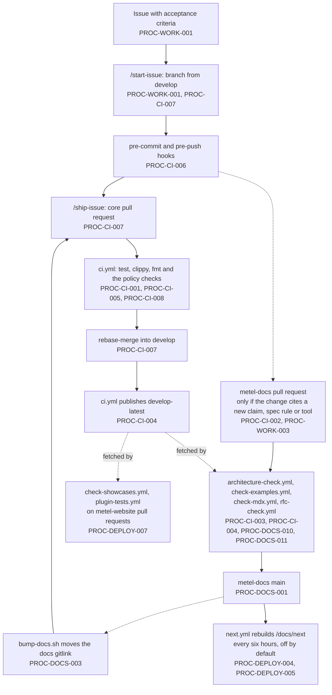
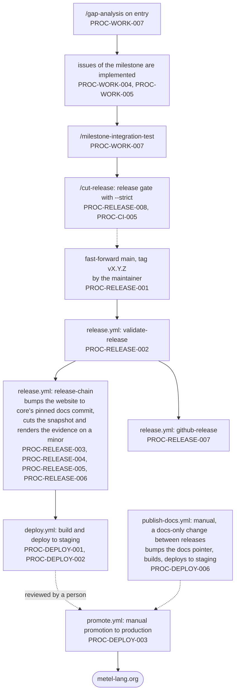

# Operations flows

Two pictures of the pipeline: how a change becomes part of `develop`, and how `develop` becomes a
release on the site. They are drawings of the requirements, not a second source: every node names
the requirement it depicts (`PROC-…`) and the workflow, script or command that performs it, and
`check_operations.py` fails or warns when a picture goes stale (PROC-CI-008):

- a node that cites a requirement or an asset that no longer exists;
- a workflow or slash command that no node mentions, unless it is listed under [Not drawn](#not-drawn);
- an implemented requirement that no node cites, unless it is listed under Not drawn;
- a node that says `manual` for a workflow that also runs on events, or the reverse.

Solid arrows are automated. A dotted arrow is a step a person takes.

## Implementation flow

## Release flow

## Not drawn

Requirements that state a rule rather than a step, and assets that are aids, with the reason.

| Item | Reason |
|---|---|
| `/new-rfc` | starts a draft RFC; part of the RFC lifecycle, not of the delivery pipeline (PROC-DOCS-008) |
| `/review-typechecker` | a review aid with no contract (marked `local` in the inventory) |
| `PROC-RELEASE-009` | a rule about credentials that every step above obeys |
| `PROC-DOCS-002` | a rule about who pins which commit; the pins are the gitlink and website bumps drawn above |
| `PROC-DOCS-004` | generation at publish time; its release-time instance is drawn in `release-chain` (PROC-RELEASE-005) and `next.yml` |
| `PROC-DOCS-005` | a rule about generated output; its checks run inside the CI nodes |
| `PROC-DOCS-006` | hand-typed review commits; audited by the CI checks and enforced at the gate |
| `PROC-DOCS-007` | the Pending marker; checked by the CI nodes and enforced at the gate |
| `PROC-DOCS-008` | the RFC lifecycle, a flow of its own run by `rfc.py` |
| `PROC-DOCS-009` | the lifecycle of gap and limitation records, run inside the CI nodes |
| `PROC-DOCS-012` | what the spec fixture viewer embeds, a build-time property |
| `PROC-WORK-002` | which tier of verification a change gets, a rule that applies to every node |
| `PROC-WORK-003` | pairing a change with its documentation and changelog, a rule applied at the pull request |
| `PROC-WORK-006` | where bugs are scheduled, a rule about milestones rather than a step |
| `PROC-WORK-008` | when work stops and asks, a rule about the agent |
